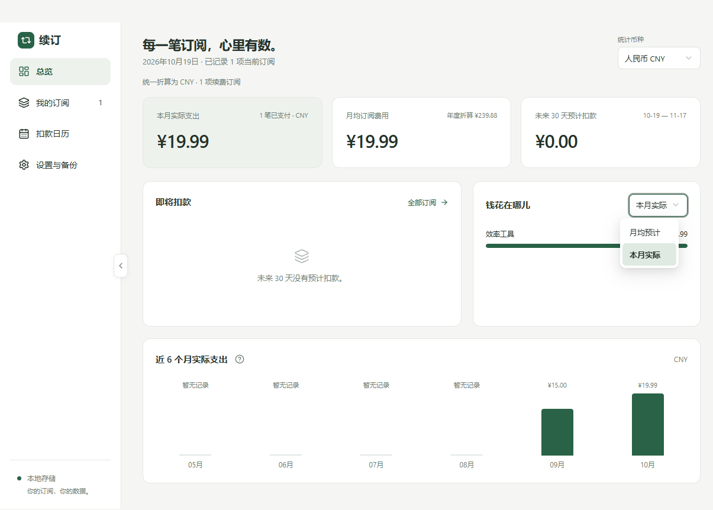
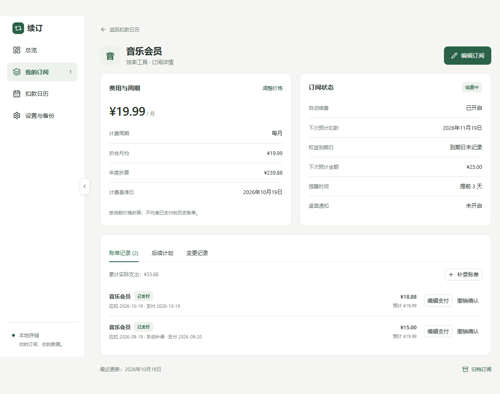
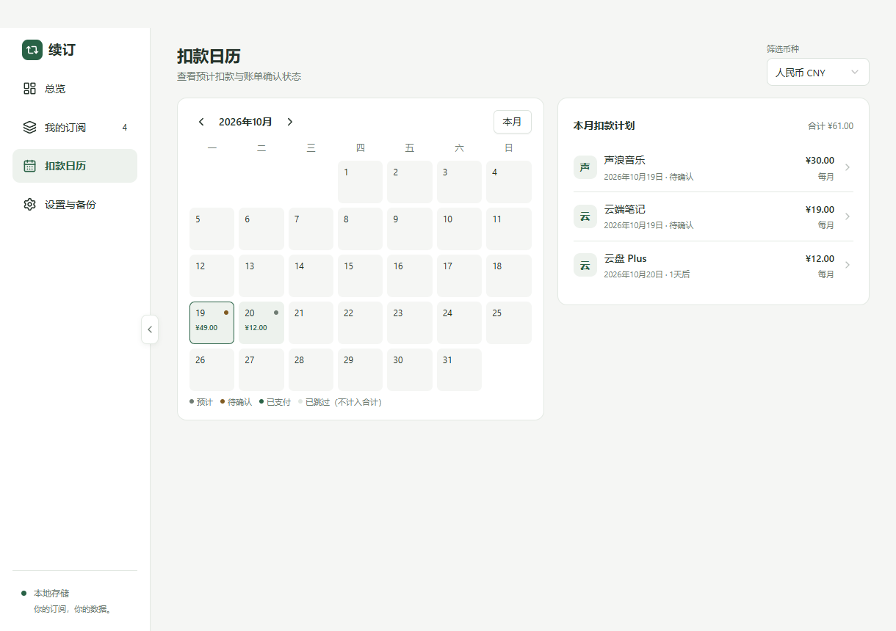

# 续订 · Xuding

一个本地优先的开源桌面订阅管理器。看清每月的长期负担、近期预计扣款，以及需要处理的试用和续费。

**Windows 优先 · 离线可用 · SQLite 本地存储 · MIT**







## 当前功能

- **总览**：全部续费订阅统一换算为所选展示币种，汇总本月实际支出、月均订阅费用（附年度折算）、未来 30 天预计扣款与分类支出，并显示近六个月实际支出趋势；展示币种默认人民币，记住手动选择，新增或编辑订阅不会改变它。
- **我的订阅**：新增、搜索、分类与状态筛选、归档；点击项目先进入详情。
- **订阅图标**：新增与编辑时可上传、更换、移除 PNG / JPG（最大 5 MB），按原比例压缩到 128 像素内，保存在本地数据库并随 JSON 备份导出；旧版无图标数据可直接读取。
- **订阅详情**：费用与续费状态、账单记录、后续三期和价格变更页签、备注和服务商链接；点击“编辑订阅”进入编辑，保存或取消后回到详情。
- **账单**：从启用当天跟踪，到期生成待确认账单，关闭应用后重启会补生成；确认支付、修改实际金额 / 币种 / 支付日期、跳过、撤销与历史补录。归档后保留历史实际支出。
- **价格计划**：专门的调价弹窗设置新价格、币种和生效日期，历史账单保留原金额；账单操作记录可在详情查看。
- **权益到期**：关闭续费后可单独填写权益到期日，列表与详情显示剩余天数；总览集中显示临近结束的试用、即将到期及已经到期的权益，不自动归档。
- **扣款日历**：紧凑日期格显示当天扣款总额及确认状态；宽窗口左侧日历、右侧明细，窄窗口自动上下排列。可按日期筛选、恢复整月计划，并进入订阅详情。
- **计费规则**：按月 / 年及自定义间隔、免费试用、月底与闰年处理。
- **多币种**：支持人民币、美元、欧元、港币；订阅保存原始币种与金额，总览按同一份参考汇率换算，扣款明细同时显示原币。日历明确使用独立的“筛选币种”。
- **参考汇率**：通过 [Frankfurter](https://frankfurter.dev/) 获取欧洲央行每日参考汇率，首次需要换算时更新并本地缓存，支持手动刷新。离线使用缓存并标明日期；缺少汇率时不显示不完整总额，原币扣款仍可查看。
- **后台与启动**：托盘双击恢复窗口，菜单支持打开、添加订阅和退出；首次关闭可选择后台运行或退出并记住选择。Windows 安装版支持可选开机启动及随系统启动时收起到托盘，默认关闭。
- **桌面提醒**：明确开启后，在前台或托盘后台检查续费、试用结束与权益到期；休眠恢复和解锁后再次检查，同期去重，点击通知进入对应详情。
- **备份**：默认自动备份，修改后合并当天快照，默认保留最近 14 天；可更改目录、立即备份及查看历史。导入或恢复前预览新增、覆盖和保留数量，并自动保存恢复前快照，失败时停止恢复；额外保留最近 10 份恢复前快照。
- **窗口与导航**：浅灰标题栏保留系统窗口按钮；侧栏分界线中部的箭头或 `Ctrl+B` 可平滑收起侧栏为图标栏，重启后记住状态，并遵循系统减少动态效果设置。
- **统一控件**：Ant Design 文本框、数字输入、中文日期选择、下拉框、开关和问号提示；下拉箭头随展开状态切换，支持键盘操作并跟随系统深浅色。

首次启动为空账本，不会把演示数据混进真实记录。预计扣款需确认后才计入**实际支出**；实际金额按支付日期归属月份，保留支付时参考汇率快照。关闭本地续费开关或归档不会替用户取消服务商扣费。

总览的月均、年度折算与扣款计划统计所有币种下开启续费且未归档的订阅。已关闭续费的订阅仍保留在列表与订阅数量中，不计入预计支出。参考换算不含银行手续费，不代表实际结算金额。图标包含在备份中，备份导入支持最大 50 MB；含图标的新备份需要 v0.1.6 或更高版本读取。

v0.3 的账单、价格、统计与升级规则见 [账单与实际支出](docs/v0.3.md)。新版 v2 备份包含账单、价格历史、跟踪进度和支付汇率快照，需要 v0.3 或以上版本恢复；仍支持旧版 v1 备份。v0.2 的系统集成规则见 [日常使用与数据保障](docs/v0.2.md)。

## 技术架构

```text
React 界面
    ↓ 类型化 API（contextBridge）
Electron preload：固定 IPC 通道
    ↓ 校验来源、数据结构与字段
Electron 主进程：订阅仓储 / 文件对话框 / 桌面提醒
    ↓
SQLite：订阅 / 账单 / 价格 / 操作记录 / 设置 / 提醒去重
```

| 层       | 选型                                             |
| -------- | ------------------------------------------------ |
| 桌面壳   | Electron 44                                      |
| 界面     | React 19、TypeScript、Ant Design 6、Lucide、CSS  |
| 构建     | electron-vite、Vite                              |
| 本地存储 | SQLite，使用 Electron 内置 Node 的 `node:sqlite` |
| 数据校验 | Zod；数据库写入前再次校验                        |
| 测试     | Vitest、Playwright Electron                      |
| 安装包   | electron-builder / NSIS，Windows x64             |

完整设计和阶段边界见 [架构与开发方案](docs/architecture.md)。

## 本地开发

需要 Node.js **24 LTS**（24.0.0 及以上）、npm 和 Git。首次安装会下载 Electron。

```bash
npm ci
npm run dev
```

```bash
npm run check       # TypeScript + 计费 / SQLite 测试
npm run test:e2e    # 构建并启动真实 Electron 窗口验证主要流程
npm run build      # 生成 out/
npm start          # 运行构建产物
npm run pack       # 生成未安装的应用目录
npm run dist:win   # 生成 release/ 下的 Windows x64 NSIS 安装包
```

Electron 测试需要图形会话；GitHub Actions 使用 Windows runner。安装包暂未签名，正式发布的代码签名与自动更新将在后续版本配置。macOS / Linux 的适配和打包尚未验证。

## 数据与隐私

- 数据保存在 Electron 的 `userData` 目录，Windows 通常为 `%APPDATA%\xuding\xuding.db`，不在源码仓库内。
- 可设置 `XUDING_DATA_DIR` 为绝对目录以使用独立数据空间，适合测试或便携使用；未设置时使用默认目录。
- 无账号、遥测、远程数据库或订阅服务抓取。
- 汇率由主进程请求固定的 Frankfurter HTTPS 接口，仅请求 EUR、CNY、USD、HKD 公共汇率，不发送订阅名称、金额或其他账本内容；本机 SQLite 保存缓存，断网仍可管理订阅。
- 数据库和 JSON 备份未加密，请自行保护本机账户与备份位置。
- 备份 v2 包含订阅、账单、价格、跟踪进度、账单操作记录与支付汇率快照；全局汇率缓存、应用偏好、订阅编辑审计和已发送提醒不随 JSON 导出。
- 升级旧库前在数据库旁保存 SQLite 安全快照，再执行事务迁移；开始跟踪之前的支付由用户补录。
- 导入按订阅 ID 合并，相同 ID 连同其账单和价格历史覆盖，其他订阅完整保留；旧版备份不清除已有账单。确认前预览变化，恢复前自动保存快照。
- 桌面提醒依赖应用运行与系统通知设置，退出应用或系统休眠时不会发送。

## 项目结构

```text
src/main/          应用生命周期、受限 IPC、SQLite 仓储
src/preload/       页面与主进程之间的类型化桥接
src/shared/        数据结构、校验、纯计费计算
src/renderer/src/  React 页面与样式
tests/             业务、存储与真实桌面流程测试
docs/              架构、功能边界与开发路线
.github/workflows/ 自动检查和 Windows 构建
```

## 下一步

预算、CSV 导入导出、签名发布与自动更新。详见架构文档中的里程碑。

欢迎通过 Issue 描述问题或提交 PR。贡献说明见 [CONTRIBUTING.md](CONTRIBUTING.md)。代码遵循 [MIT License](LICENSE)。
