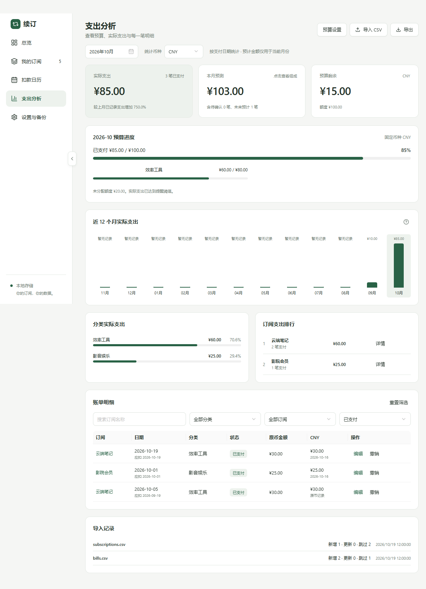
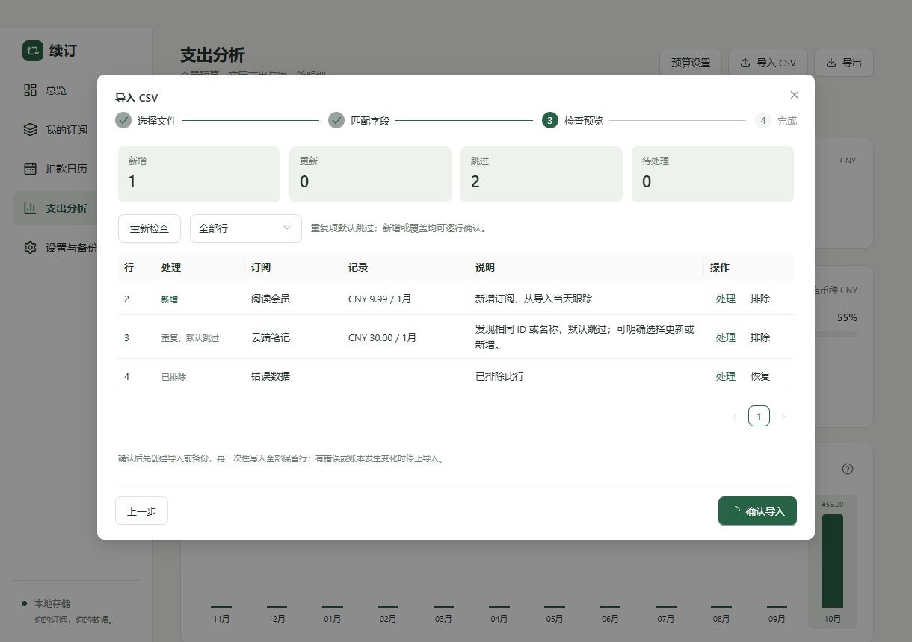
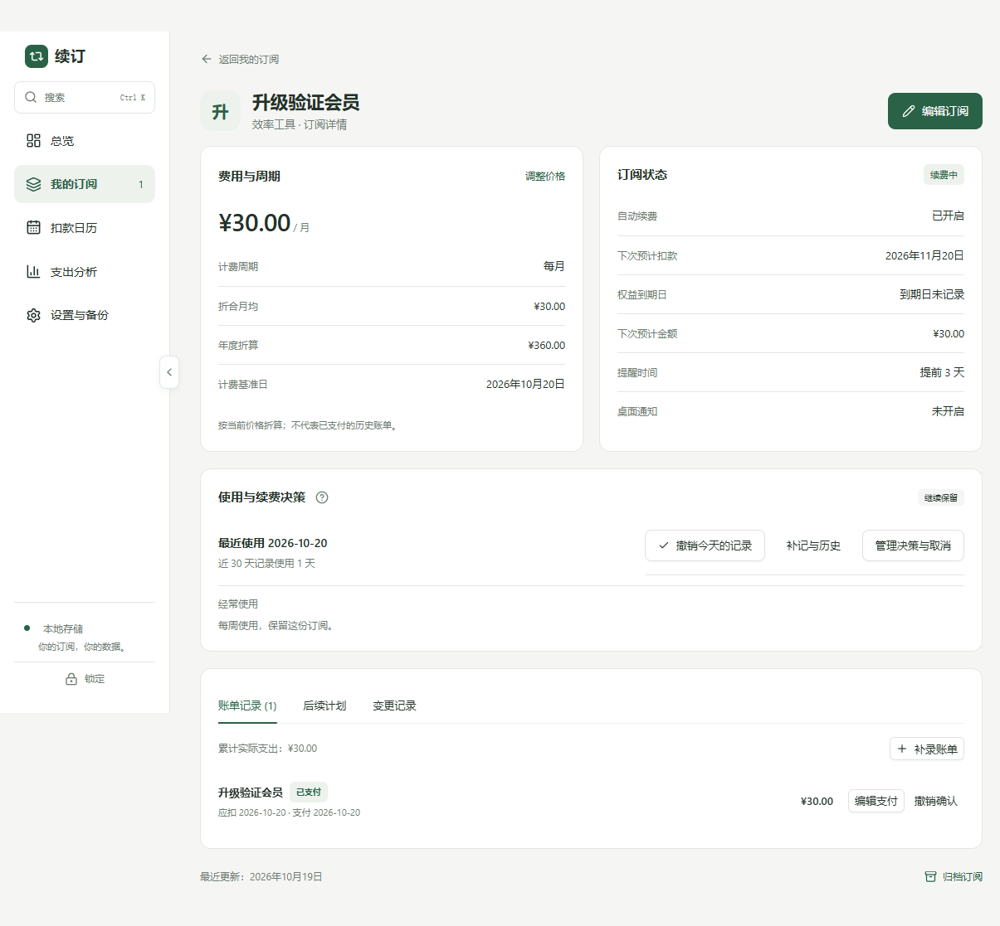
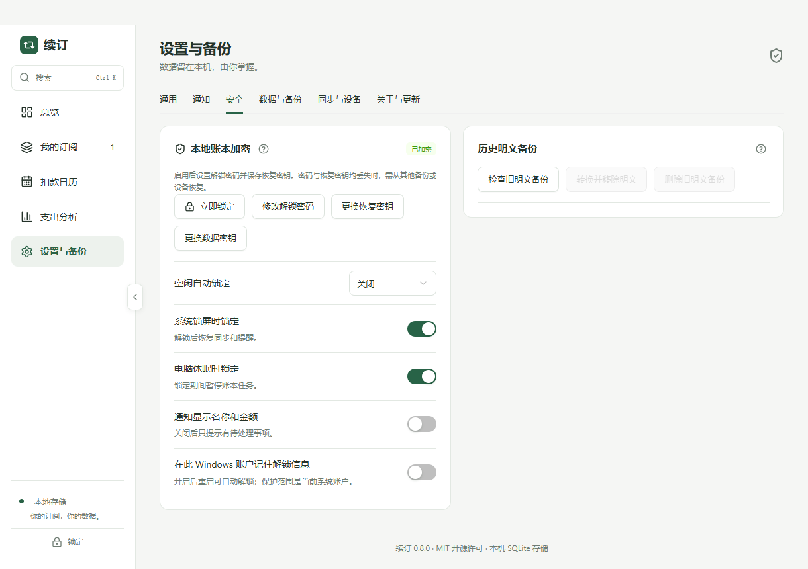
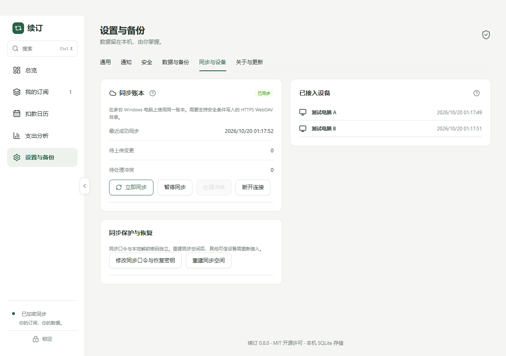

# 续订 · Xuding

一个本地优先的开源桌面订阅管理器。看清每月的长期负担、近期预计扣款，以及需要处理的试用和续费。

**Windows 优先 · 离线可用 · SQLite 本地存储 · MIT**













## 当前功能

- **使用与决策**：今天用过、补记/撤销、使用频率、续费决定和备注、评估日期、取消申请与确认、权益结束后可选自动归档；无记录不推断为闲置。
- **本地安全**：可选数据库加密、启动解锁、锁屏/休眠/空闲锁定、恢复密钥、密码更换与通知隐私；加密恢复点及旧明文文件处理。
- **多电脑同步**：用户自选 HTTPS WebDAV，业务快照加密、首次合并预览、离线编辑、ETag 并发保护、三方合并、冲突处理和同步密钥更换。
- **快捷与分析**：Ctrl+K 全局搜索、列表筛选排序记忆与快捷操作；月均费用变化来源、实际支付变化与独立汇率影响。

- **总览**：全部续费订阅统一换算为所选展示币种，汇总本月实际支出、月均订阅费用（附年度折算）、未来 30 天预计扣款与分类支出，并显示近六个月实际支出趋势；展示币种默认人民币，记住手动选择，新增或编辑订阅不会改变它。
- **月度预算**：独立币种的总预算与分类分配，后续月份沿用、历史配置保留；总览显示实际进度与本月预测，桌面阈值通知可独立开启。
- **支出分析**：近十二个月实际支出、分类占比、订阅排行、可筛选与操作的账单明细；预测区分已支付、待确认与剩余预计。
- **CSV 数据迁移**：订阅 / 账单分别导入导出，支持字段映射、UTF-8 / GB18030、日期顺序、重复识别、行修正与关联创建；预览后先备份再事务写入，可完整恢复撤销整批导入。导出兼容 Excel 中文，并可保存模板。
- **我的订阅**：新增、搜索、分类与状态筛选、归档；点击项目先进入详情。
- **订阅图标**：新增与编辑时可上传、更换、移除 PNG / JPG（最大 5 MB），按原比例压缩到 128 像素内，保存在本地数据库并随 JSON 备份导出；旧版无图标数据可直接读取。
- **订阅详情**：费用与续费状态、账单记录、后续三期和价格变更页签、备注和服务商链接；点击“编辑订阅”进入编辑，保存或取消后回到详情。
- **账单**：从启用当天跟踪，到期生成待确认账单，关闭应用后重启会补生成；确认支付、修改实际金额 / 币种 / 支付日期、跳过、撤销与历史补录。归档后保留历史实际支出。
- **价格计划**：专门的调价弹窗设置新价格、币种和生效日期，历史账单保留原金额；账单操作记录可在详情查看。
- **权益到期**：关闭续费后可单独填写权益到期日，列表与详情显示剩余天数；总览集中显示临近结束的试用、即将到期及已经到期的权益；可明确开启权益结束后自动归档。
- **扣款日历**：紧凑日期格显示当天扣款总额及确认状态；宽窗口左侧日历、右侧明细，窄窗口自动上下排列。可按日期筛选、恢复整月计划，并进入订阅详情。
- **计费规则**：按月 / 年及自定义间隔、免费试用、月底与闰年处理。
- **多币种**：支持人民币、美元、欧元、港币；订阅保存原始币种与金额，总览按同一份参考汇率换算，扣款明细同时显示原币。日历明确使用独立的“筛选币种”。
- **参考汇率**：通过 [Frankfurter](https://frankfurter.dev/) 获取欧洲央行每日参考汇率，首次需要换算时更新并本地缓存，支持手动刷新。离线使用缓存并标明日期；缺少汇率时不显示不完整总额，原币扣款仍可查看。
- **后台与启动**：托盘双击恢复窗口，菜单支持打开、添加订阅和退出；首次关闭可选择后台运行或退出并记住选择。Windows 安装版支持可选开机启动及随系统启动时收起到托盘，默认关闭。
- **桌面提醒**：明确开启后，在前台或托盘后台检查续费、试用结束与权益到期；休眠恢复和解锁后再次检查，同期去重，点击通知进入对应详情。
- **备份**：默认自动备份，修改后合并当天快照，默认保留最近 14 天；手动备份长期保留，可更改目录、立即备份及查看历史、另存和删除。导入或恢复前预览新增、覆盖和保留数量，并自动保存恢复前快照，失败时停止恢复；额外保留最近 10 份导入、同步或恢复前快照。支持密码加密备份，凭据可由当前 Windows 账户保护；错误密码或文件校验失败不写入账本。
- **更新与恢复**：应用内检查正式版，用户主动下载和安装；签名清单及 SHA-512 校验，安装前保存升级副本。账本启动异常时提供独立恢复窗口，支持本地脱敏诊断导出。
- **窗口与导航**：浅灰标题栏保留系统窗口按钮；侧栏分界线中部的箭头或 `Ctrl+B` 可平滑收起侧栏为图标栏，重启后记住状态，并遵循系统减少动态效果设置。
- **统一控件**：Ant Design 文本框、数字输入、中文日期选择、下拉框、开关和问号提示；下拉箭头随展开状态切换，支持键盘操作并跟随系统深浅色。

首次启动为空账本，不会把演示数据混进真实记录。预计扣款需确认后才计入**实际支出**；实际金额按支付日期归属月份，保留支付时参考汇率快照。关闭本地续费开关或归档不会替用户取消服务商扣费。

总览的月均、年度折算与扣款计划统计所有币种下开启续费且未归档的订阅。已关闭续费的订阅仍保留在列表与订阅数量中，不计入预计支出。参考换算不含银行手续费，不代表实际结算金额。图标包含在备份中，备份导入支持最大 50 MB；含图标的新备份需要 v0.1.6 或更高版本读取。

v0.8 合并订阅决策、本地安全和多设备同步，完整规则见 [v0.8](docs/v0.8.md)。数据库结构升级至 5，备份业务格式为 v4，仍可导入旧版。v0.5 可通过应用内更新；本地加密与 WebDAV 同步由用户主动开启。请保存恢复密钥及独立加密备份。

v0.4 的预算、CSV、完整恢复与升级规则见 [预算、分析与数据迁移](docs/v0.4.md)。新版 v3 备份包含预算、导入批次与账单折算来源，需要 v0.4 或以上版本恢复；仍支持旧版 v1 / v2 备份。历史规则见 [v0.3](docs/v0.3.md) 与 [v0.2](docs/v0.2.md)。

CSV 模板：[订阅清单](docs/templates/subscriptions.csv) · [账单记录](docs/templates/bills.csv)。

## 技术架构

```text
React 界面
    ↓ 类型化 API（contextBridge）
Electron preload：固定 IPC 通道
    ↓ 校验来源、数据结构与字段
Electron 主进程：订阅仓储 / 文件对话框 / 桌面提醒
    ↓
SQLite：订阅 / 账单 / 价格 / 操作记录 / 设置 / 提醒去重
```

| 层       | 选型                                                                                  |
| -------- | ------------------------------------------------------------------------------------- |
| 桌面壳   | Electron 44                                                                           |
| 界面     | React 19、TypeScript、Ant Design 6、Lucide、CSS                                       |
| 构建     | electron-vite、Vite                                                                   |
| 本地存储 | SQLite；明文用 `node:sqlite`，加密用 SQLite3 Multiple Ciphers（SQLCipher 4 兼容模式） |
| 数据校验 | Zod；数据库写入前再次校验                                                             |
| 测试     | Vitest、Playwright Electron                                                           |
| 安装包   | electron-builder / NSIS，Windows x64                                                  |

完整设计和阶段边界见 [架构与开发方案](docs/architecture.md)。

## 本地开发

需要 Node.js **24 LTS**（24.0.0 及以上）、npm 和 Git。首次安装会下载 Electron。

```bash
npm ci
npm run dev
```

```bash
npm run check       # TypeScript + 计费 / SQLite 测试
npm run test:e2e    # 构建并启动真实 Electron 窗口验证主要流程
npm run build      # 生成 out/
npm start          # 运行构建产物
npm run pack       # 生成未安装的应用目录
npm run dist:win   # 生成 release/ 下的 Windows x64 NSIS 安装包
```

Electron 测试需要图形会话；GitHub Actions 使用 Windows runner。安装包暂未进行 Windows 发布者代码签名；应用内更新已提供独立的清单签名与安装包校验。正式版通过受保护发布环境签名更新清单，私钥不在仓库内。macOS / Linux 的适配和打包尚未验证。

## 数据与隐私

- 数据保存在 Electron 的 `userData` 目录，Windows 通常为 `%APPDATA%\xuding\xuding.db`，不在源码仓库内。
- 可设置 `XUDING_DATA_DIR` 为绝对目录以使用独立数据空间，适合测试或便携使用；未设置时使用默认目录。
- 无续订账号、遥测或订阅服务抓取。可选同步只连接用户配置的 WebDAV 服务，上传内容经客户端加密。
- 汇率由主进程请求固定的 Frankfurter HTTPS 接口，仅请求 EUR、CNY、USD、HKD 公共汇率，不发送订阅名称、金额或其他账本内容；本机 SQLite 保存缓存，断网仍可管理订阅。
- 可选本地数据库加密与独立加密备份；普通 JSON/CSV 导出是明文。系统凭据保护以当前 Windows 账户为边界。历史明文副本需单独处理。
- 备份 v4 包含订阅、账单、价格、跟踪进度、业务历史、支付汇率快照、预算、导入批次、使用、决策和参考汇率历史；应用偏好、同步凭据和本地解锁信息不随账本导出。
- 升级旧库前在数据库旁保存 SQLite 安全快照，再执行事务迁移；开始跟踪之前的支付由用户补录。
- 导入按订阅 ID 合并，相同 ID 连同其账单和价格历史覆盖，其他订阅完整保留；旧版备份不清除已有账单或预算；v3/v4 支持显式选择完整恢复，移除快照外记录以撤销整批导入。确认前预览变化，恢复前自动保存快照。
- 桌面提醒依赖应用运行与系统通知设置，退出应用或系统休眠时不会发送。

## 项目结构

```text
src/main/          应用生命周期、受限 IPC、SQLite 仓储
src/preload/       页面与主进程之间的类型化桥接
src/shared/        数据结构、校验、纯计费计算
src/renderer/src/  React 页面与样式
tests/             业务、存储与真实桌面流程测试
docs/              架构、功能边界与开发路线
.github/workflows/ 自动检查和 Windows 构建
```

## 下一步

Windows 发布者签名、多平台适配与同步服务兼容性扩展。当前发布范围见 [v0.8](docs/v0.8.md)。

欢迎通过 Issue 描述问题或提交 PR。贡献说明见 [CONTRIBUTING.md](CONTRIBUTING.md)。代码遵循 [MIT License](LICENSE)。
