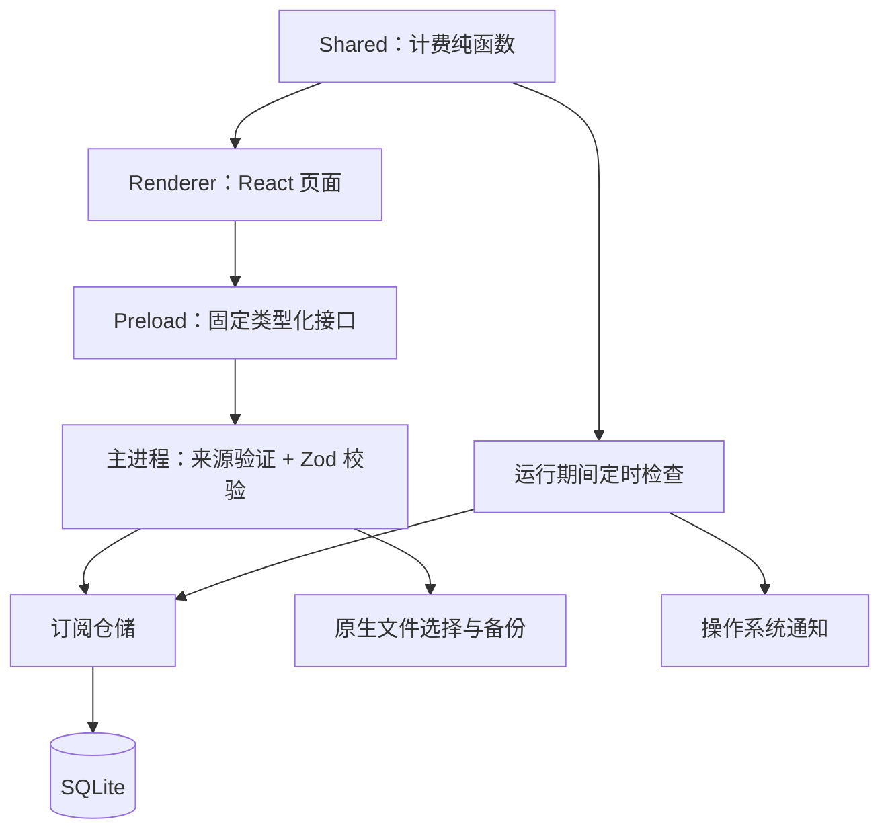

# 续订：桌面应用架构与开发方案

状态：v0.1 初始实现。目标平台：Windows 10/11 x64。产品名：续订；项目名：xuding。

## 1. 产品目标与已确认交互

围绕“订了什么、长期花多少、下一笔何时扣、哪些需要处理”组织功能。

- **总览**负责概览与提醒，不展示新增订阅按钮；新增入口位于“我的订阅”。
- **列表 → 详情 → 编辑**：点击订阅项目先查看详情；编辑是详情中的显式操作。
- 保存或取消编辑回到详情；详情返回原入口，保留列表筛选和日历选择。
- 总览与日历内的订阅同样进入详情。
- 首次运行无演示数据。无网络时，核心账本功能仍可使用。
- 未来扣款为预测，实际支付与服务商取消由用户确认，首版不会执行支付或自动取消。

## 2. 技术栈与取舍

| 技术                        | 用途               | 选择原因 / 代价                                                                                               |
| --------------------------- | ------------------ | ------------------------------------------------------------------------------------------------------------- |
| Electron 44                 | 桌面窗口、系统集成 | 复用已确认的 Web 界面；统一 TypeScript 开发。需要随版本维护 Chromium，安装包与内存开销较高。                  |
| React 19 + TypeScript       | 视图与交互         | 拆分总览、列表、详情、编辑、日历和设置；类型共享到桌面桥接层。                                                |
| electron-vite + Vite        | 开发与构建         | 同时管理主进程、preload 和 renderer 的构建。                                                                  |
| Ant Design 6 + CSS + Lucide | 视觉系统           | 下拉框、开关、提示统一使用组件库；绿色主题与深浅色同步，支持键盘操作、减少动态效果及窗口缩放。                |
| SQLite / node:sqlite        | 本地持久化         | 单文件数据库、事务、参数化语句；使用内置模块避免额外原生扩展编译。内置 API 的版本变更需随 Electron 升级回归。 |
| Zod                         | 运行时验证         | 表单、IPC、备份、数据库反序列化共享约束。                                                                     |
| Vitest / Playwright         | 测试               | 纯业务规则和仓储单测；真实 Electron 窗口验证端到端流程。                                                      |
| electron-builder / NSIS     | Windows 分发       | 支持安装目录选择、快捷方式和卸载。初版未签名。                                                                |

首版不需要服务器、账号系统或云同步。所有依赖版本由 package-lock.json 锁定。

## 3. 分层与进程边界

- **Renderer**：页面、筛选、局部状态、格式化。不能直接访问文件系统、SQL 或 Node API。
- **Preload**：只暴露八个确定操作（含受限的本地图标选择），不暴露通用 `send`、`invoke`、执行脚本或读写任意文件接口。
- **Main**：校验调用来自受信窗口的主 frame；验证所有写入数据；管理数据库与原生对话框。
- **Shared**：模型、货币处理、日期、费用与预测。总览、详情、日历与提醒使用同一套逻辑。
- **存储**：当前规模适合主进程同步 SQLite。若超过数万条或增加复杂报表，再迁移到 utility process / worker，保留仓储接口。

不启用 Node Integration；启用 contextIsolation、sandbox、webSecurity；拒绝额外窗口、页面导航和网页权限请求。生产 CSP 禁止远程脚本，外链只允许 HTTP/HTTPS 且由明确点击触发。

## 4. 数据模型与迁移

v0.1 使用小型版本化文档存储在 SQLite 表中。JSON 文档必须通过 Zod 约束，ID 和更新时间为独立列。这样保留事务、审计和迁移能力，同时让第一版字段演进保持简单。

| 表                   | 字段与用途                                                         |
| -------------------- | ------------------------------------------------------------------ |
| subscriptions        | `id` 主键、`document`（受校验的订阅快照）、`updated_at`            |
| subscription_changes | 每次写入 / 归档 / 导入保存一份快照，用于后续审计；不把快照冒充账单 |
| settings             | 本地应用偏好，首版为通知开关                                       |
| reminders            | `订阅 ID:扣款日` 唯一键、发送时间；每期通知去重                    |

数据库用 `PRAGMA user_version` 标记版本。v1 初始化在事务内完成；遇到比当前版本更新的数据库时停止打开，避免旧版本改坏新结构。启用 WAL、busy timeout 与参数化语句。

订阅字段包括：UUID、名称、分类、整数分金额、币种、周期（月 / 年）、间隔 1—12、计费基准日、状态（active / trial / archived）、自动续费、提前提醒天数、网站、备注、创建时间与更新时间。

v0.1.6 增加可选 `icon` 字段，保存 PNG data URL；旧记录省略此字段仍可读取。图片由主进程原生对话框选择，校验 5 MB 上限并解码，按比例缩小至 128 像素内后重新编码；不保存源文件路径，不加载远程图标。模型限制图片类型与编码长度，图标随订阅快照和备份保留。

后续确认账单阶段新增规范化 `billing_rules`、`billing_records`：

- 计费规则带生效日期，保留价格与周期变更。
- 已确认账单保存当时的价格、币种和状态，规则修改不重写历史账单。
- 当前快照与修改记录可协助迁移，但不会推断未被用户确认的历史支付。

## 5. 费用与日期规则

1. 金额按最小货币单位（分）存整数；字符串拆分转换，避免直接浮点乘 100 的误差。当前四种币种均按两位小数处理。
2. `月均 = 单期金额 ÷ 周期间隔月数`；年均为未提前舍入的月均乘 12。合计之后才按分舍入。
3. 未来 30 天为今天至今天 + 29 天，含首尾；预计扣款合计使用实际单期金额。
4. 计费日期为不带时区的 `YYYY-MM-DD`；计算采用 UTC 日历运算，今天按操作系统本地时区取日，避免夏令时造成天数偏移。
5. 31 日订阅在短月份取月底，下期仍从原始 31 日计算；2 月 29 日年付在平年取 2 月 28 日，闰年回到 29 日。
6. 试用的基准日是首笔付费日，之前不产生预测；概览折算包含试用转付费后的价格，并明示该口径。
7. 关闭自动续费或归档后，不再生成未来扣款与计入长期费用。首版不管理剩余权益到期日。
8. 币种独立统计，不做无汇率依据的直接相加。自动汇率换算属于后续功能。
9. 修改金额会改变未来预测；历史快照保留，首版不提供实际扣款确认。

## 6. 备份、提醒和异常

**备份 v1**：`format=xuding`、版本、导出时间、订阅数组（含可选图标）。只导出当前订阅，不含通知设置、修改快照和提醒历史。原生对话框确定保存位置。导入上限 50 MB / 10,000 项，完整校验日期、金额、URL、图标格式、ID 唯一性后，用户确认覆盖规则，再在单事务内按 ID 合并。新版可读取无图标的旧备份；含图标的备份需要 v0.1.6 或以上应用。

**提醒**：默认关闭，用户开启后，在启动后和运行期间每分钟检查；达到提前天数且该期未提醒才通知。系统报告通知显示后记录去重键。当天恢复应用可以补发当期提醒；已过期账单不追补。v0.1 无托盘驻留、开机启动和系统级离线调度；实际提醒受系统通知设置影响。

**错误**：表单错误保留输入；IPC 返回受控结果；数据库失败在界面显示错误；启动失败给出原生错误对话框。导入失败不会留下部分数据。重复实例聚焦已有窗口。

## 7. 开发里程碑

| 阶段          | 交付                                                               | 状态 / 验收                                                    |
| ------------- | ------------------------------------------------------------------ | -------------------------------------------------------------- |
| v0.1 本地账本 | 桌面壳、页面、SQLite、计费、日历、详情编辑、归档、备份、运行期提醒 | 本仓库初始实现；计费和仓储测试、真实桌面流程测试、Windows 构建 |
| v0.2 日常使用 | 托盘、关闭行为设置、开机启动、通知失败重试、提醒测试、CSV 导入导出 | 待实现；需验证睡眠 / 唤醒 / 重启行为                           |
| v0.3 账单历史 | 价格生效日期、实际账单确认、历史趋势、预算                         | 待实现；规则变更不修改已确认账单                               |
| 发布完善      | 应用图标与品牌、签名证书、版本更新、完整安装 / 卸载验证            | 图标随初版提供；签名、自动更新待实现                           |
| 可选扩展      | macOS / Linux、加密备份、手动同步、家庭共享                        | 根据实际需求决定；不会默认上传本地数据                         |

## 8. 验证与开源协作

- 计费测试覆盖月底、闰年、自定义周期、试用边界、币种隔离、30 天边界和金额输入。
- SQLite 测试覆盖增改归档、备份合并、非法 / 重复 ID 的原子拒绝、偏好和提醒去重。
- Electron 测试覆盖空账本、无总览新增、列表进入详情、编辑取消 / 保存、备份、重启保留和归档。
- Windows CI 运行检查和真实桌面测试，随后构建 NSIS 并保存 workflow artifact。
- 开源采用 MIT。仓库仅提交源码、锁文件、图标、文档和测试；不提交数据库、个人账本、密钥、node_modules 或安装产物。

## 官方参考

- [Electron 安全指南](https://www.electronjs.org/docs/latest/tutorial/security)
- [Electron 版本](https://releases.electronjs.org/)
- [electron-vite](https://electron-vite.org/guide/)
- [Node SQLite API](https://nodejs.org/api/sqlite.html)
- [electron-builder](https://www.electron.build/)
