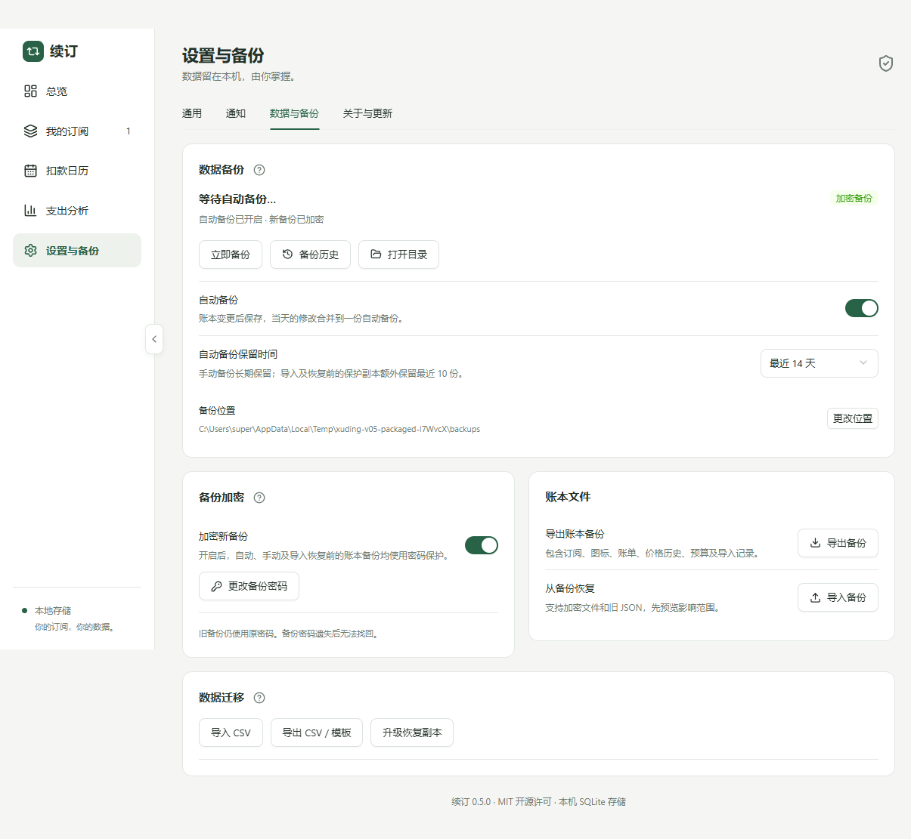
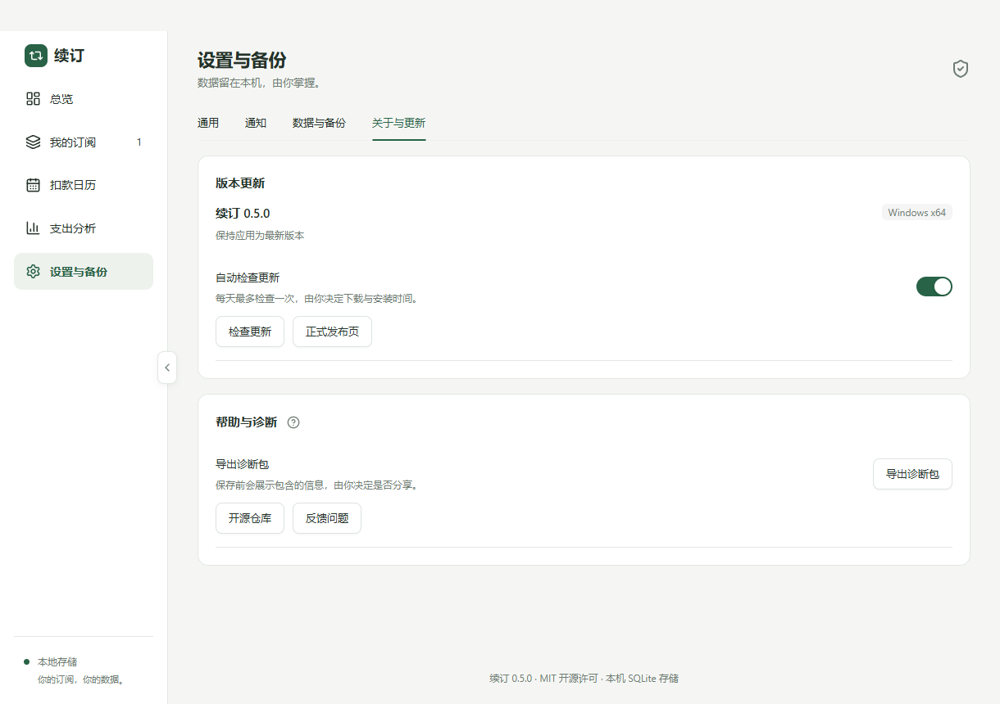

# v0.5：备份保护与可靠更新

目标平台为 Windows x64。继续使用现有 Electron、React、Ant Design、SQLite；数据库结构仍为 4，账本备份内部格式仍为 v3。v0.4 用户手动安装 v0.5 一次，后续可在应用内检查、下载并主动安装正式版。

## 设置与备份

设置改为通用、通知、数据与备份、关于与更新四个页内标签。本窗口会话记住选中的标签；页脚保持底部居中。密码输入、弹窗、开关、选择与进度使用 Ant Design，遵循深浅色和减少动态效果。





备份历史支持来源、文件大小、加密状态、异常状态、恢复、另存与删除。加密文件不泄漏账本数量，输入密码验证后展示恢复摘要。损坏的普通文件会显示异常，不能恢复。应用只操作受限文件名且拒绝符号链接；不会清理备份目录内其他文件。

保留策略：自动备份默认 14 天，可选 7/14/30/90 天；手动备份长期保留；CSV 导入前和恢复前保护副本合计最近 10 份。启用加密后，之前的明文备份保持原状并明确标识。

## 加密文件格式

`.xudingbackup` 是 JSON 外层封装，`format=xuding-encrypted`、`version=1`。内部仍为通过 Zod 校验的 v3 账本，可独立于 Windows 账户用密码恢复。

- scrypt：N=32768、r=8、p=1，32 字节随机盐、32 字节派生密钥，maxmem 64 MiB。
- AES-256-GCM：每份文件独立 12 字节 nonce、16 字节验证标签。
- 文件格式版本、派生参数、盐、加密算法及 nonce 作为 AAD 认证，防止头部篡改。
- 参数只接受上述固定值；拒绝不支持的格式、异常 Base64、过大文件或变造参数，避免恶意文件要求高资源派生。
- 明文有效负载上限 50 MiB；加密封装文件上限 72 MiB。密码为 12—256 个字符，支持中文与空格。
- 使用异步 scrypt；密钥和可控临时 Buffer 在使用后清零。JavaScript 字符串仍由运行时回收，因此不宣称完全消除进程内存中的密码痕迹。

每次启用或更改自动备份密码，先通过系统保护保存凭据，再创建并解密验证一份备份；成功后才切换策略。凭据失败时暂停保护备份，不能静默改为明文。密码变更只影响后续文件；旧文件仍需旧密码。密码遗失无法找回。

Windows 凭据使用 Electron safeStorage / DPAPI，密文单独保存在用户数据目录 credentials/，数据库仅保留随机凭据 ID。凭据不随账本 JSON 导出。此保护以当前 Windows 账户为边界，不能防御同一账户下所有程序。

本机 SQLite 数据库及升级前数据库副本仍未加密。普通 JSON 和 CSV 导出也未加密；界面明确显示相关说明。

## 恢复与升级保护

文件选择在主进程进行，渲染进程只拿到 10 分钟有效的 token。加密文件验证成功后进入恢复预览；失败不改变账本。预览包含新增、覆盖、保留/移除订阅及账单、价格和预算数量。

旧 v1/v2/v3 JSON 继续兼容。按 ID 合并保留其他记录；完整恢复只接受包含完整业务数据的 v3，并恢复预算与导入批次。设备偏好和备份凭据保持本机状态。恢复前先写保护副本并核对修订号，副本失败或账本已变化时停止；数据库事务确保失败不留下半批数据。

应用版本改变时，在打开账本前生成一致性 SQLite 副本；安装更新前额外保存当前状态。启动时检查 SQLite 完整性、结构版本及业务数据约束。无法打开账本时显示独立恢复界面，不进入正常账本页面。

恢复副本前先验证；正常运行时额外保存账本备份，随后关闭数据库。故障数据库及其 WAL/SHM 关联文件分别另存为带唯一后缀的故障文件，副本拷贝验证成功后再替换。恢复失败尽可能回退原文件，保留诊断及故障文件。旧应用遇到较新数据库会停止打开并提示升级，不自动降级数据。

成功启动后保留最近 3 个通过验证的数据库恢复点；故障启动不执行自动清理。故障文件由用户检查后处理，不自动删除。

## 更新协议与发布

使用 electron-updater 6.8.9 的 NSIS 更新支持，固定使用本仓库的正式 Release。自动检查默认开启，每天最多一次；自动下载、退出时自动安装和版本降级均关闭。用户主动下载并确认安装；网络失败可重试，也可打开正式发布页。

签名协议独立于 electron-builder 的 latest.yml：

1. `xuding-update.json` 包含 Base64 payload 和 Ed25519 签名；客户端内置 resources/update-trust.json 的公钥。
2. payload 包含格式、正式版号、固定命名的 x64 安装包、SHA-512、字节数、更新说明及发布时间。
3. 先验证签名和字段；再通过 electron-updater 读取该版本 latest.yml，严格匹配版本、文件名、SHA-512、大小，拒绝额外包或其他文件。
4. 下载完成再次计算本地 SHA-512，安装前再检查一次。校验失败禁止安装，不执行普通退出安装。
5. 安装前确认用户意图，检查活跃写操作，阻止后续账本请求，等待备份队列并生成数据库恢复点；退出时关闭数据库。

下载缓存会保留；重启应用后需点击下载重新载入并验证更新器缓存，通常不需要重新传输安装包，该过程需要取得版本元数据。首版不保证中断文件按字节续传，失败时可安全重试。

签名清单与安装包校验不能代替 Windows Authenticode。当前安装包没有 Windows 发布者代码签名；若未来配置证书，仍保留 electron-updater 自带的发布者校验，不通过清单签名关闭它。

发布环境 release 存放 XUDING_UPDATE_PRIVATE_KEY。私钥不能提交仓库或打包进客户端。标签必须与 package.json 正式版号一致。release.yml 先检查、真实桌面测试、构建、签名，创建包含安装包、latest.yml、xuding-update.json 的草稿；从草稿下载产物并重新验证签名和哈希，通过后才发布。失败时保留草稿以便检查。

本地发布产物生成：

```powershell
npm run check
npm run test:e2e
npm run dist:win
$env:XUDING_UPDATE_PRIVATE_KEY_FILE = '可信位置的私钥文件'
node scripts/release.mjs
node scripts/verify-release.mjs
```

公钥更换属于客户端信任变更，需要使用旧信任发布能识别新密钥的过渡版本；不要仅替换发布环境私钥。当前协议单公钥，完整多密钥轮换需后续扩展。

## 本地诊断

日志记录应用版本、系统类型、操作事件、时间和有限错误标识；不记录原始异常文本、订阅、金额、备注、密码、CSV 或个人路径。不自动上传。

按日期轮转，保留最近 7 天，总大小不超过 20 MiB。导出前显示内容范围，用户选择保存位置；JSON 诊断包不包含数据库、备份、凭据或完整路径。

## 验证

- 密码文件随机性、认证失败、错误密码、异常参数、跨凭据环境恢复、轮换与丢失凭据保护。
- 明文历史兼容、手动长期保留、异常文件显示、目录边界、保护副本来源。
- 签名变造、元数据不一致、下载后修改、安装前保护失败、主动安装与缓存偏好。
- 故障数据库保留、关联文件处理及从恢复点重新打开。
- 真实 Electron 覆盖设置标签、密码配置、密码错误、历史恢复、脱敏导出、深色窄窗及独立恢复界面。
- Windows 安装版额外检查旧库升级，并通过隔离的应用 ID、安装目录、用户数据和测试发布源验证真实 NSIS 更新，避免改动日常账本。
